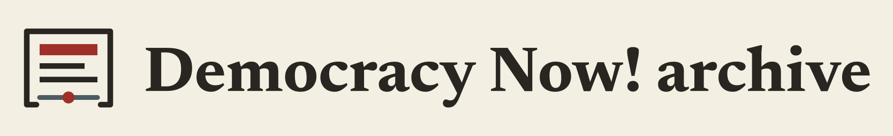

# Democracy Now! broadcast archive



An independent viewer for Democracy Now! broadcasts held at Internet Archive. Watch a program from the beginning, or join the replay already playing on a shared scheduled channel. The original broadcast date stays with every program.

This repository holds the viewer's frontend, design and deployment configuration. The catalog and API come from SUBCULT's shared archive engine, which runs as a pinned container image. Video streams directly from Internet Archive: this app never downloads, proxies, caches or transcodes it.

Public site: https://democracy-now.subcult.tv/

## Features

- A broadcast library in grid or table view, with metadata filters and original dates.
- On-demand playback from the start of any program.
- A shared replay channel. **Tune in** joins the program at its current position; **Rejoin** returns to it after you pause. Your controls never change the channel's schedule.
- Theater mode.
- Share links by copying, by email or to Bluesky.
- Favorites saved in your browser, with a separate favorites shelf.
- Source attribution and a link to Democracy Now! on every page.

Optional sign-in, saved preferences and a channel chat are built into the frontend but switched off in the standard deployment. Anonymous viewing does not need them.

## Quick start

Requirements: Node.js 24 and pnpm 10.33.0. The `@subcult` packages install from the registry set in [`web/.npmrc`](web/.npmrc).

```sh
pnpm --dir web install --frozen-lockfile
pnpm --dir web dev
```

Vite serves the app on port 5173 and proxies `/api` to `http://127.0.0.1:8080`. Set `VHNESS_API` to point it at another archive engine API.

Checks:

```sh
make verify   # engine and viewer pins, tool hashes, frozen install, typecheck, lint, tests, production build
```

## Deploy

[`deploy/core-compose.yml`](deploy/core-compose.yml) runs PostgreSQL, the archive engine API, this frontend and an `operator` profile for migrations and catalog commands. The frontend image is built from [`deploy/frontend.Dockerfile`](deploy/frontend.Dockerfile): nginx serving the static app and proxying `/api` to the engine.

```sh
docker compose --env-file deploy/archive-core.env -f deploy/core-compose.yml up -d
```

Set these before starting:

| Variable | Purpose |
| --- | --- |
| `ARCHIVE_ENGINE_IMAGE` | Engine image, pinned by digest in [`deploy/archive-core.env`](deploy/archive-core.env) |
| `FRONTEND_IMAGE` | Tag of the frontend image you built |
| `COLLECTION` | Engine collection to serve (`democracy_now_vid`) |
| `MEDIA_ROOT` | Media folder mounted read-only; empty for this collection, which streams from the source |
| `SECRET_ROOT` | Folder holding the `database-password`, `database-url` and `operator-database-url` files |
| `NPMRC_FILE` | npm configuration used while building the frontend image |
| `WEB_PORT` | Loopback port for the frontend (default 8080) |

Run the operator's `migrate` before the API, use a read-only database role for the public API, and put HTTPS in front of the frontend. [`deploy/community-compose.yml`](deploy/community-compose.yml) is an optional overlay that adds routing for accounts and chat; see [`docs/community.md`](docs/community.md).

## Project layout

```text
web/       React and Vite frontend (built on @subcult/archive-viewer)
deploy/    Compose files, nginx configuration, engine and viewer pins
scripts/   Pin and hash checks, image build and deployment helpers
docs/      Brand assets, asset provenance and deployment notes
```

## Contributing

- Bugs and feature requests: [GitHub issues](https://github.com/subculture-collective/democracy-now-tv/issues).
- Code: pull requests on GitHub against `main`. CI runs `make verify` and builds the frontend image on every pull request. Both must pass.

## License and rights

The software is licensed under GPL-3.0. See [LICENSE](LICENSE).

Broadcasts, the Democracy Now! logo and the photograph used in the header belong to their owners and are not covered by the software license. [Asset provenance](docs/asset-provenance.json) records where the shipped logo and photograph came from. This is an independent archive viewer. It is not made, run or endorsed by Democracy Now!.
